# UniVance – Comprehensive UML, DFD & Architecture Diagrams (Mermaid)

All diagrams are architected specifically for the **UniVance Cloud-Native Academic & Inter-Institutional Event Intelligence Platform** (React.js + Node.js/Express.js + MongoDB, orchestrated on AWS EKS). Each diagram is designed to fit cleanly on standard A4 documentation and adheres strictly to Mermaid syntax standards.

---

## 1. DFD Level 0 (Context Diagram)

The Level 0 Data Flow Diagram illustrates the foundational operational boundary of UniVance. It depicts external entities—Internal Students, External Inter-College Students, Department Organizers, Institutional Administrators, and External Micro-Services (Brevo SMTP & Cloud Storage)—interacting with the central UniVance platform.

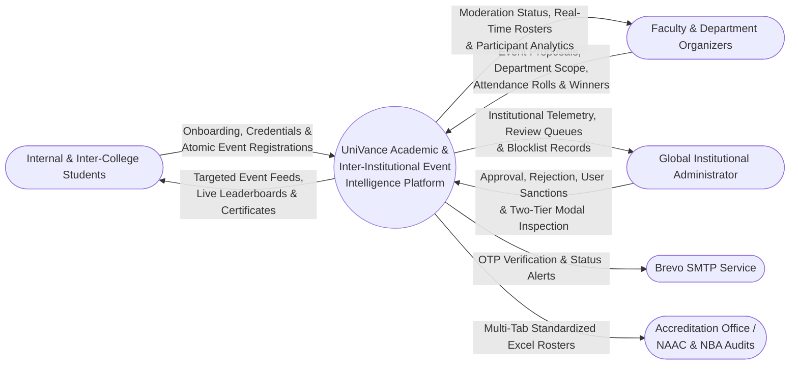

---

## 2. DFD Level 1 (High-Level System Decomposition)

The Level 1 DFD decomposes UniVance into five fundamental processing subsystems, illustrating the flow of data between user personas and persistent database stores.

```mermaid
flowchart TB
    subgraph Entities[External Entities]
        Student([Student])
        Organizer([Organizer])
        Admin([Campus Admin])
        EmailService([Brevo SMTP Engine])
    end

    subgraph Processes[Core Application Processes]
        P1((1.0 Authentication,<br/>IAM & Sanction Guard))
        P2((2.0 Logic-Gated<br/>Event Engine))
        P3((3.0 Atomic Enrollment<br/>& Team Management))
        P4((4.0 Admin Moderation<br/>& Two-Tier Telemetry))
        P5((5.0 Accreditation Reporting<br/>& Certificate Engine))
    end

    subgraph DataStores[MongoDB Persistent Collections]
        D1[(D1 Users & Sanctions)]
        D2[(D2 Events & Scopes)]
        D3[(D3 Registrations & Teams)]
        D4[(D4 Winners & Leaderboards)]
        D5[(D5 Certificates & Logs)]
    end

    Student -->|Signup with Roll No/Class & Login| P1
    Organizer -->|Signup with Dept & Login| P1
    Admin -->|Administrative Authentication| P1
    P1 -->|Dispatch OTP / Verification| EmailService
    P1 <-->|Read / Write Identity & Block Status| D1

    Organizer -->|Propose Event with Target Depts & Scope| P2
    P2 <-->|Store & Query Events| D2
    D1 -.->|Verify Organizer Affiliation| P2

    Student -->|Discover & Join Event| P3
    P3 <-->|Atomic Roster Mutation| D3
    D2 -.->|Verify Target Dept & Seat Balances| P3

    Admin -->|Approve/Reject & Block/Unblock| P4
    P4 <-->|Update Sanction & Review State| D1
    P4 <-->|Update Event Moderation State| D2

    Organizer -->|Declare Winners & Finalize Roster| P5
    Admin -->|Request Accreditation Roster (.xlsx)| P5
    P5 <-->|Store Winners & Certification Map| D4
    P5 <-->|Store Issued Digital Certificates| D5
    D3 -.->|Aggregate Participant Demographics| P5
```

---

## 3. DFD Level 2 (Decomposition of Process 2.0 & Process 4.0)

### 3.1 Process 2.0: Event Proposal & Logic-Gated Scoping

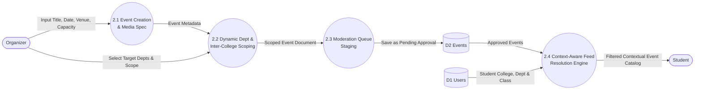

---

### 3.2 Process 4.0: Administrative Moderation, Two-Tier Filtering & User Sanctions

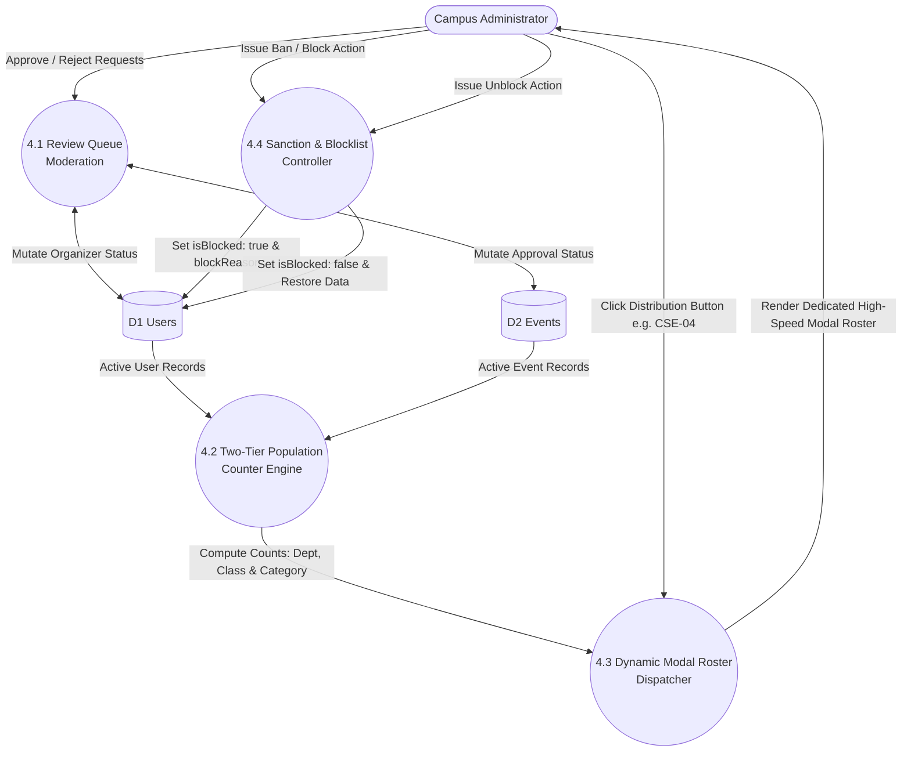

---

## 4. Use Case Diagram

The Use Case Diagram models interactions across all three primary system actors (**Student**, **Organizer**, and **Administrator**) and external integration engines, highlighting the new functional capabilities introduced in UniVance Phase 1.

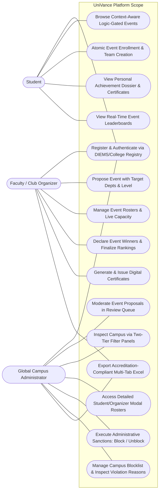

---

## 5. Class Diagram (Model Architecture)

The Class Diagram reflects the underlying Mongoose object schemas, encapsulating student credentials, dynamic target departments, inter-college scoping, two-tier distribution structures, and administrative sanction flags.

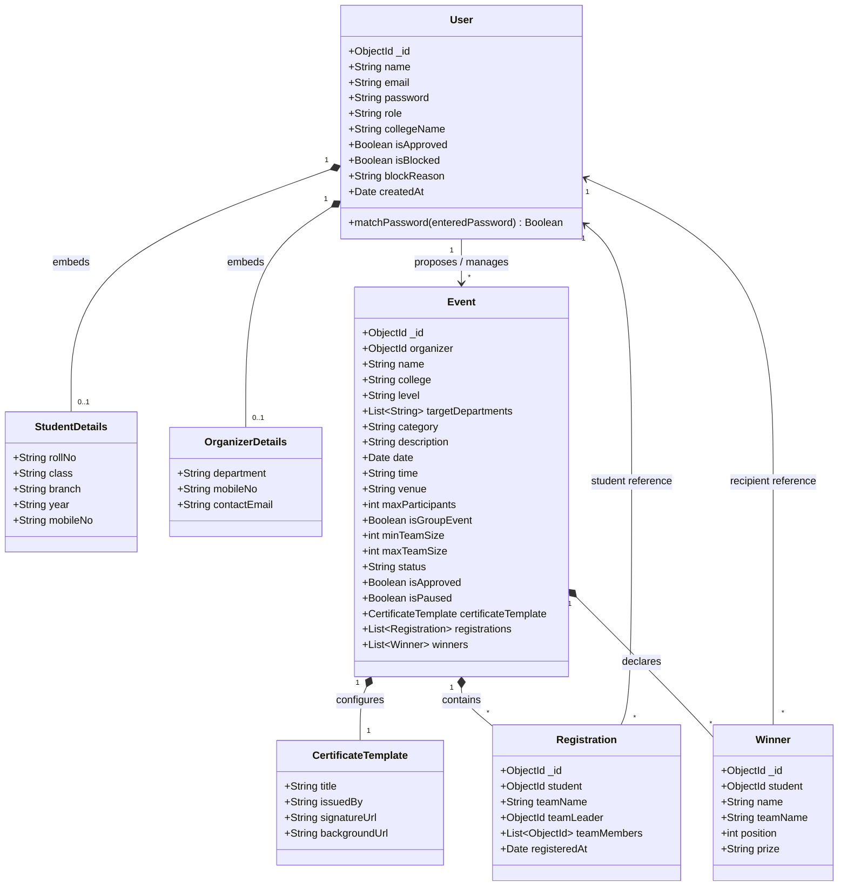

---

## 6. Sequence Diagrams

### 6.1 Event Lifecycle with Dynamic Department & Inter-College Resolution

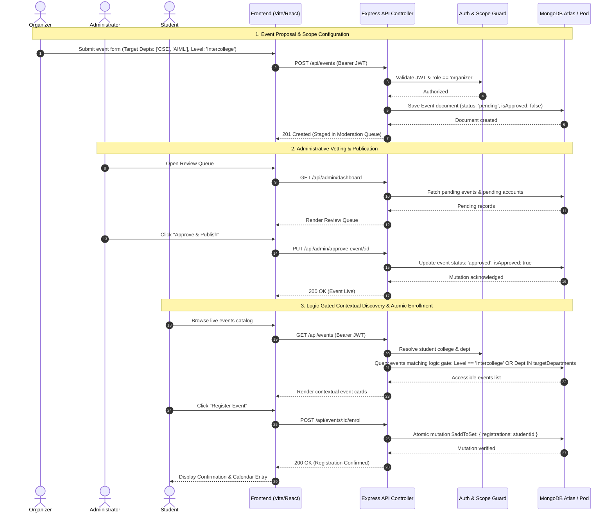

---

### 6.2 Administrative Sanctions: Account Blocking & Non-Destructive Restoration

```mermaid
sequenceDiagram
    autonumber
    actor Admin as Administrator
    actor Stud as Student
    participant Client as Frontend UI
    participant API as Admin Controller
    participant Auth as Auth Middleware
    participant DB as MongoDB

    Note over Admin,DB: 1. Administrative Account Sanction (Blocking)
    Admin->>Client: Click "Block User" from Directory / Approval Queue
    Client->>Admin: Prompt for Sanction Reason
    Admin-->>Client: "Misconduct in campus lab"
    Client->>API: PUT /api/admin/block-user/:id { reason }
    API->>DB: Update User: isBlocked = true, blockReason = reason
    DB-->>API: Updated
    API-->>Client: 200 OK (User moved to Blocklist)

    Note over Stud,DB: 2. Blocked User Access Rejection
    Stud->>Client: Attempt Login or API Request
    Client->>API: POST /api/users/login OR Authenticated Route
    API->>Auth: Check user.isBlocked
    Auth-->>API: isBlocked == true
    API-->>Client: 403 Forbidden: "Account restricted by administrator"
    Client-->>Stud: Display Dedicated Banned Screen with Contact Info

    Note over Admin,DB: 3. Non-Destructive Account Restoration (Unblocking)
    Admin->>Client: Open Blocklist Tab -> Click "Unblock Student"
    Client->>API: PUT /api/admin/unblock-user/:id
    API->>DB: Update User: isBlocked = false, isApproved = true, blockReason = ''
    DB-->>API: Restored
    API-->>Client: 200 OK (Account Restored)
    Note over Stud,DB: Student can log in immediately; all past registrations & certificates remain 100% intact
```

---

## 7. Activity Diagram (Dynamic Event Lifecycle & Department Gating)

The Activity Diagram models the decision logic governing event creation, administrative review, target department evaluation, and student enrollment verification.

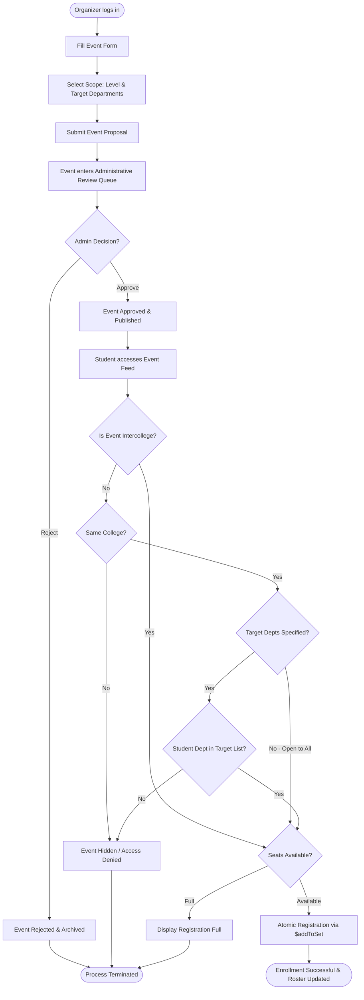

---

## 8. State Chart Diagrams

### 8.1 Event State Lifecycle

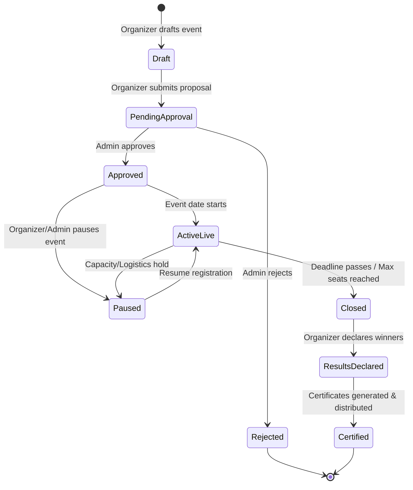

---

### 8.2 User Account & Sanction Lifecycle (Finite State Machine)

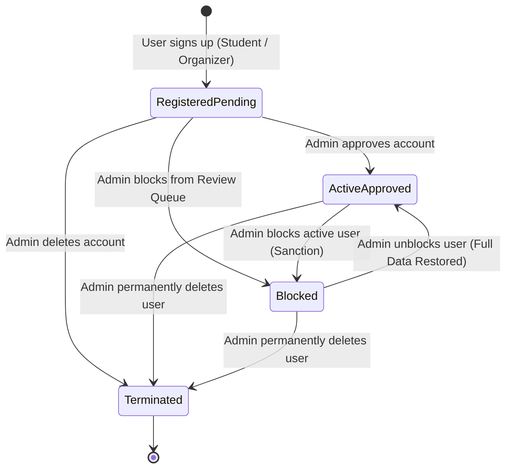

---

## 9. Component Diagram (Micro-Orchestrated System Architecture)

The Component Diagram models UniVance's internal software modularity and communication protocols within the containerized runtime.

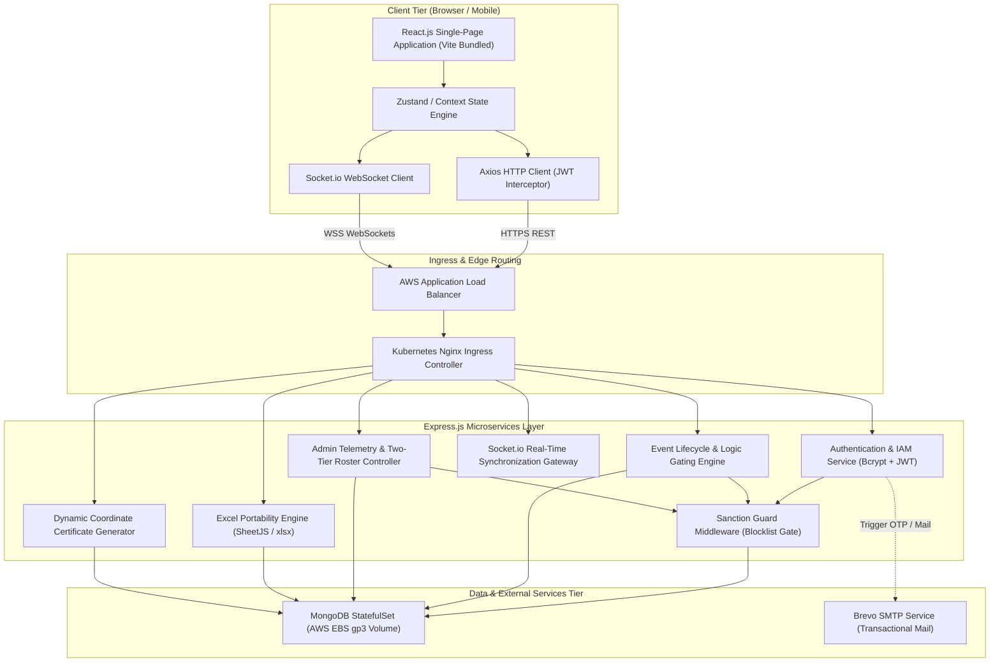

---

## 10. Deployment Diagram (AWS EKS Cloud-Native Cluster Topology)

The Deployment Diagram details the multi-availability-zone infrastructure on Amazon Web Services, illustrating Kubernetes Pod placements, Auto Scaling Groups, persistent storage claims, and load-balancer routing.

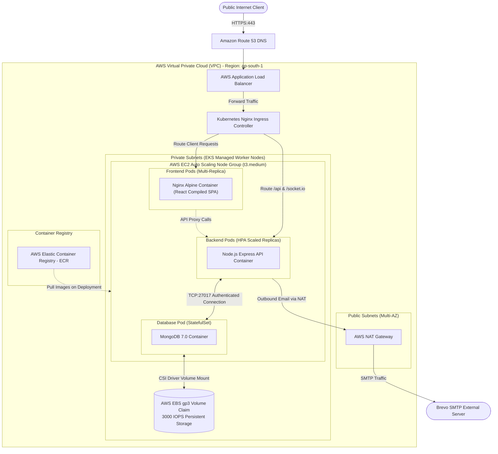

---

## 11. Entity Relationship (ER) Diagram

The Entity Relationship diagram visualizes database schema associations, foreign key references, and multi-college document embeds.

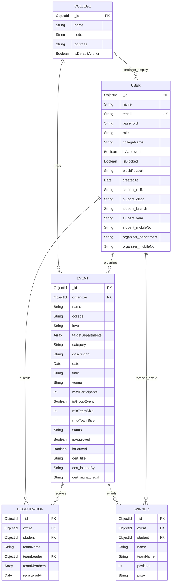
